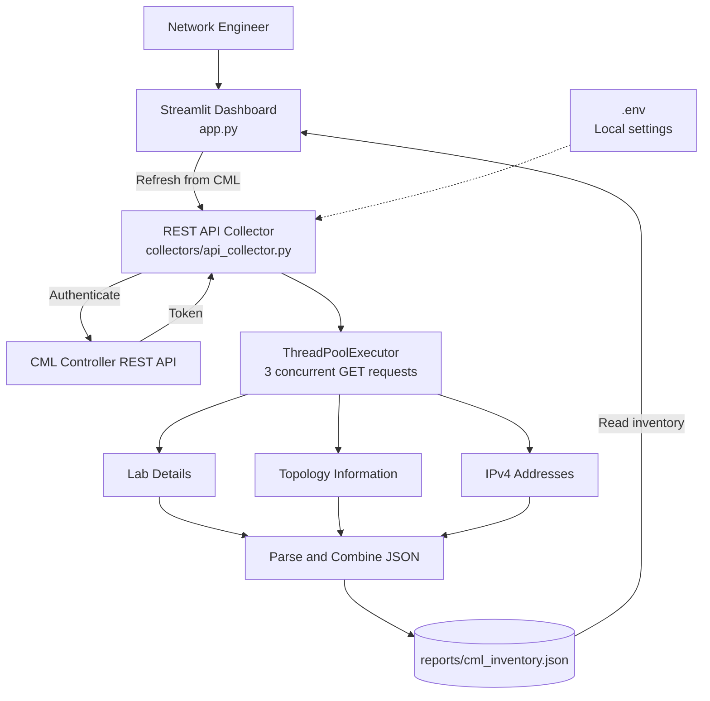
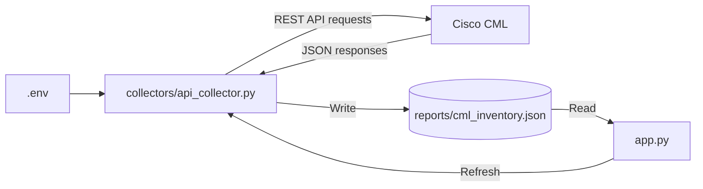

# Cisco CML REST API Automation

A Python-based network inventory application that collects information from **Cisco Modeling Labs (CML)** using REST APIs and displays it in a **Streamlit** dashboard.

The application authenticates with CML, requests lab details, topology details, and interface IPv4 information **concurrently**, and combines the results into one JSON report.

## Features

- Retrieve lab title, description, node count, and link count
- List Cisco IOSv routers and IOSvL2 switches
- Display device types, mapped SSH ports, interface names, and IPv4 addresses
- Run three REST API GET requests concurrently with `ThreadPoolExecutor`
- Filter devices and interfaces in a Streamlit dashboard
- Refresh from CML and download the resulting JSON report
- Load sample data when CML is not connected

## Architecture



## Project structure

```text
cisco-cml-rest-api-automation/
├── collectors/
│   ├── __init__.py
│   └── api_collector.py      # Authentication, concurrent GETs, JSON parsing
├── docs/
│   └── dashboard-preview.png              
├── reports/
│   ├── sample_inventory.json # Sample data for offline preview
│   └── cml_inventory.json    # Created after collection 
├── .env                     # Local connection details 
├── .gitignore
├── app.py                   # Interactive Streamlit dashboard
├── README.md
└── requirements.txt
```

### Python file interaction



## CML endpoints

| Method | Endpoint | Data |
|---|---|---|
| POST | `/api/v0/authenticate` | Bearer token |
| GET | `/api/v0/labs/{lab_id}` | Lab name and summary |
| GET | `/api/v0/labs/{lab_id}/topology` | Nodes, types, interfaces, SSH port tags |
| GET | `/api/v0/labs/{lab_id}/layer3_addresses` | Interface IPv4 address information |

## Setup

**1. Open the project folder in VS Code.**

**2. Install dependencies** (Python 3.10+):

```powershell
python -m pip install -r requirements.txt
```

**3. Create `.env` with CML controller URL, lab ID, username, and password:

```dotenv
CML_BASE_URL=https://cml-controller/api/v0
CML_LAB_ID=lab-id
CML_USERNAME=username
CML_PASSWORD=password
CML_VERIFY_SSL=false
CML_TIMEOUT=10
```

**4. Run the collector** to save fresh data:

```powershell
python -m collectors.api_collector
```

This writes `reports/cml_inventory.json`.

**5. Start Streamlit:**

```powershell
streamlit run app.py
```

Open the local address displayed in the terminal (typically `http://localhost:8501`). 

## Sample JSON output

[`reports/sample_inventory.json`](reports/sample_inventory.json).

`"unassigned"` means the IP endpoint returned an empty IPv4 list; `"unavailable"` means it did not report that interface. Neither value indicates whether a port is administratively up or down.